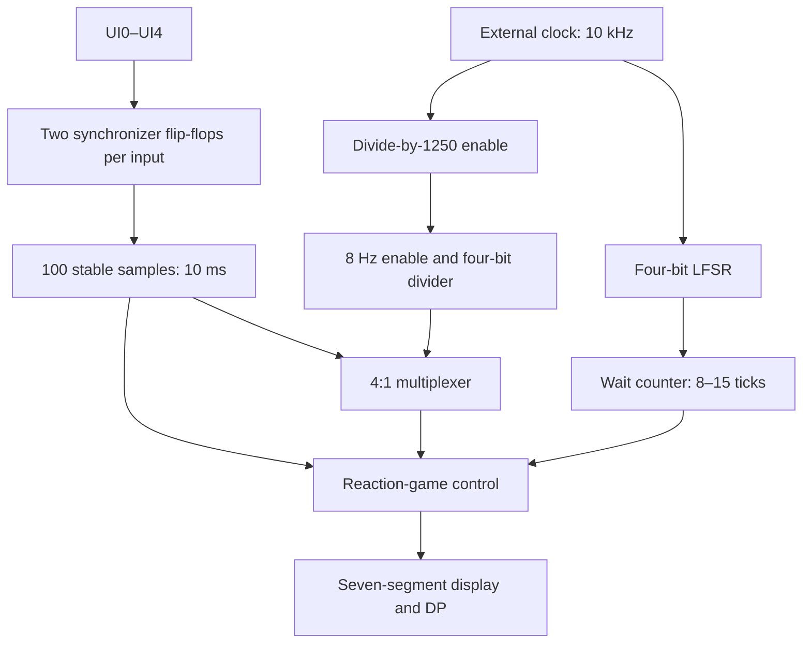

# Architecture and operation



## Debounce sequence

1. Two flip-flops sample each external control to reduce metastability risk.
2. A sample matching the accepted level clears the discrepancy counter.
3. A different sample advances the counter. Any return to the accepted level restarts qualification.
4. After 100 consecutive different samples, the accepted level changes and the counter clears.
5. Game logic consumes only these filtered controls.

For example, high for 4 ms, low for 1 ms, then high for 4 ms does not qualify as a press. A continuous 10 ms high interval, plus synchronization latency, does. Release uses the same rule.

## Clock division and selection

There are no generated clocks. An 11-bit prescaler emits an enable once every 1250 clock cycles. The four-bit divider increments and the wait counter decrements only on this enable. Divider bits generate 4, 2, 1 and 0.5 Hz; UI1:UI0 select them in reverse order.

Edge detection and response processing run at 10 kHz. Without a response, the cue lasts exactly 10000, 5000, 2500 or 1250 clock cycles. The edge-detector latency shifts both boundaries equally.

## Pseudo-random wait

The four-bit XNOR LFSR advances at 10 kHz:

```verilog
rng <= {rng[2:0], ~(rng[3] ^ rng[2])};
```

It starts at zero and visits 15 states, excluding 1111. The round captures `{1'b1, rng[2:0]}`, giving a wait count of 8–15. This count decrements at 8 Hz. When it reaches zero, the game waits for the selected rising edge before opening the cue. Total waiting time includes loading, count alignment and waveform phase; it is not exactly the nominal countdown duration.

## Response and results

An accepted high response while the cue was high wins. An earlier accepted response loses. A falling edge without a response loses. Results remain latched until round reset.

A response already accepted on the opening edge counts as early. An accepted response on the closing edge takes priority over timeout. The original cue equations are retained, including a possible one-cycle cue with a failure result at the opening boundary.

Display outputs are active high: bit 0=a, bit 6=g, bit 7=DP. Difficulty patterns are 0x06, 0x5B, 0x4F and 0x66. Success is 0x3D; failure is 0x71.

## Reset behavior

The global reset conditioner asserts asynchronously and releases after synchronization plus 100 stable cycles. The rest of the circuit resets synchronously from `ready`. Filtered start and restart controls no longer drive a combinational asynchronous reset.

The round remains reset while filtered UI2 is low or filtered UI4 is high. The divider and LFSR keep running between rounds and clear only on global reset.
